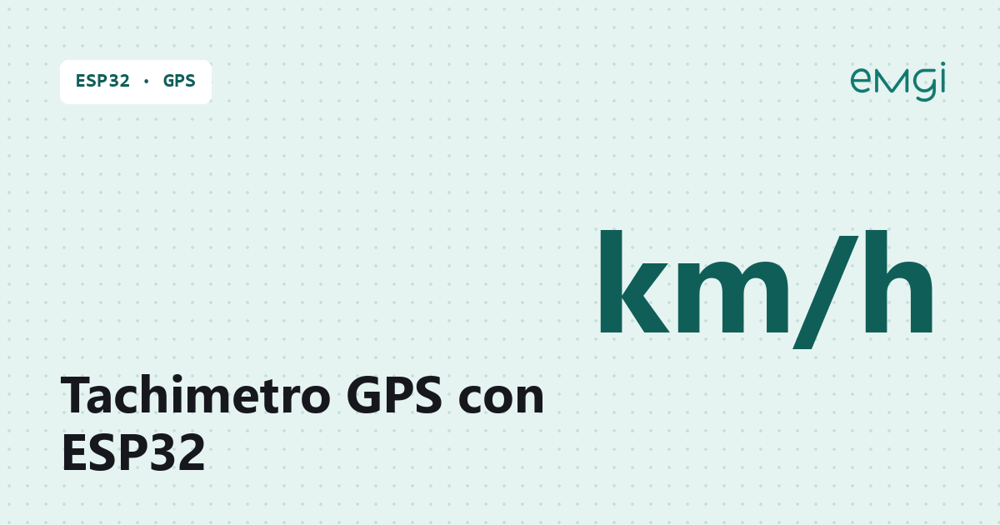

# Tachimetro GPS ESP32 con TM1637, LED RGB e luminosità automatica giorno/notte

> 📖 **Articolo completo con schema, foto e spiegazioni passo passo:**  
> **[Tachimetro GPS ESP32 con TM1637, LED RGB e luminosità automatica giorno/notte – www.emgi.it](https://www.emgi.it/2026/04/10/tachimetro-gps-di-precisione/)**
>
> Altri progetti di elettronica, Arduino, ESP32, Home Assistant e stampa 3D su **[www.emgi.it](https://www.emgi.it)**

Realizzare un tachimetro GPS fai da te è un progetto molto interessante perché unisce elettronica, programmazione, interfaccia web e stampa 3D in un unico dispositivo compatto. In questa versione finale ho realizzato un **tachimetro GPS basato su ESP32** capace di visualizzare la velocità in tempo reale su un display **TM1637 a 4 cifre**, salvare uno **storico persistente in flash**, mostrare una **pagina web professionale via Access Point Wi-Fi**, pilotare un **LED RGB a gradiente** che cambia colore in base alla velocità e regolare automaticamente la **luminosità giorno/notte** in base ad alba e tramonto calcolati localmente tramite GPS.

Il sistema utilizza il modulo **GY-NEO6MV2** per ricavare la velocità dal segnale GPS, un **ESP32 Dev Module** per la gestione generale del progetto e un display **TM1637 0,36″** per mostrare tre cifre intere e una decimale, ad esempio **53.3 km/h** oppure **123.4 km/h**.

## Caratteristiche principali

Questo tachimetro offre diverse funzioni utili:

- visualizzazione della velocità in **km/h** con una cifra decimale
- lettura della velocità da **GPS**
- display **TM1637 4 digit**
- formato corretto sul display, ad esempio **53.3** e non **5.3.3**
- **pagina web premium** ospitata direttamente sull’ESP32
- funzionamento in modalità **Access Point Wi-Fi**
- **telemetria live** con velocità, satelliti, HDOP, media e massima
- **grafico storico** della velocità media e di picco
- salvataggio dello **storico in flash** tramite **LittleFS**
- esportazione dello storico in **CSV**
- **LED RGB a catodo comune** con transizione colore graduale in funzione della velocità
- **profili luminosità giorno/notte automatici** basati su alba e tramonto
- regolazione da web della luminosità del **LED RGB** e del **display**
- memorizzazione permanente delle impostazioni in flash
- **case OpenSCAD modulare** con esportazione dei singoli pezzi in STL

## Componenti utilizzati

Per realizzare il progetto servono:

- 1 × **ESP32 Dev Module**
- 1 × **modulo GPS GY-NEO6MV2**
- 1 × **display TM1637 4 digit 0,36″**
- 1 × **LED RGB a catodo comune**
- 3 × resistenze da **220 Ω** oppure **330 Ω**
- cavetti Dupont
- alimentazione USB per ESP32
- contenitore stampato in 3D opzionale

## Librerie da installare in Arduino IDE

Per compilare il progetto sono necessarie queste librerie:

- **TinyGPSPlus**
- **TM1637Display**
- **ArduinoJson**

## Collegamenti elettrici

Scheda: **ESP32** (Dev Module). Pin verificati sullo sketch (`GPS_RX_PIN 16`, `GPS_TX_PIN 17`, `TM1637_CLK_PIN 18`, `TM1637_DIO_PIN 19`, `RGB_R/G/B_PIN 25/26/27`).

### Modulo GPS GY-NEO6MV2

| GPS | ESP32 |
|---|---|
| VCC | 5V |
| GND | GND |
| TX | GPIO16 (RX2) |
| RX | GPIO17 (TX2) |

### Display TM1637 4 cifre

| TM1637 | ESP32 |
|---|---|
| VCC | 5V |
| GND | GND |
| CLK | GPIO18 |
| DIO | GPIO19 |

### LED RGB a catodo comune

| LED RGB | ESP32 |
|---|---|
| catodo comune | GND |
| anodo rosso | resistenza 220–330 Ω → GPIO25 |
| anodo verde | resistenza 220–330 Ω → GPIO26 |
| anodo blu | resistenza 220–330 Ω → GPIO27 |

- TX del GPS va su RX dell'ESP32 (GPIO16) e viceversa.
- Il GPS ha bisogno di cielo libero per il primo fix (anche alcuni minuti a freddo).

### Alimentazione

| Uso | Come alimentare |
|---|---|
| Banco / casa | USB dell'ESP32 a 5 V |
| Auto | adattatore USB da presa accendisigari (12 V → 5 V, almeno 1 A) collegato alla USB dell'ESP32 |

- GPS, display e LED prendono 5 V e GND dai pin **5V/VIN** e **GND** dell'ESP32: l'assorbimento totale resta sotto i 200 mA.
- Il modulo GY-NEO6MV2 ha un regolatore a 3,3 V a bordo: va alimentato a 5 V e le linee TX/RX lavorano già a 3,3 V, compatibili con l'ESP32.
- Monta il GPS con l'antenna rivolta verso il cielo (sotto il parabrezza va bene).

## Contenuto del repository

| Percorso | Descrizione |
|---|---|
| `Tachimetro_GPS/Tachimetro_GPS.ino` | Sketch Arduino |
| `immagini/` | Foto e immagini dell'articolo |

## Come si usa

1. Apri [`Tachimetro_GPS/Tachimetro_GPS.ino`](Tachimetro_GPS/Tachimetro_GPS.ino) con Arduino IDE.
2. Partition Scheme: una variante **No OTA** con filesystem grande; Flash Size in base alla scheda (di solito 4 MB).
3. Collegamenti e configurazione sono descritti nell'articolo.

Schema dei collegamenti, dettagli e risoluzione dei problemi: **[articolo su www.emgi.it](https://www.emgi.it/2026/04/10/tachimetro-gps-di-precisione/)**.

## Licenza

- Codice e configurazioni: [MIT](LICENSE)
- Modelli 3D, schemi e immagini: [CC BY-SA 4.0](https://creativecommons.org/licenses/by-sa/4.0/deed.it)

---

**Autore:** Massimiliano Sandrin – **[eMGi.it](https://www.emgi.it)** · Domande e commenti sotto l'[articolo sul sito](https://www.emgi.it/2026/04/10/tachimetro-gps-di-precisione/).
